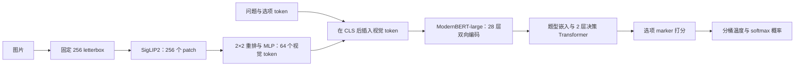

# deVision CPU 推理引擎调研

记录时间：2026-10-05 14:36:39 +08:00（Asia/Shanghai）。

范围：基于本项目实际推理图，比较 llama.cpp/ggml、ONNX Runtime、OpenVINO 和 PyTorch 编译路线。已阅读本地实现、配置、已有指标、safetensors 文件头及上游官方源码；没有导出、量化、编译、加载或运行模型。本文是调研与待执行建议，不是性能验收，不写入 `critic/`。

## 当前建议

**llama.cpp 值得作为原生 CPU 引擎的候选，而且已有 ModernBERT 和 Laya 决策头可复用。建议用小范围 deVision 适配做原型，同时以 ONNX Runtime FP32 建立对照，再按目标 CPU 的实际收益决定投入。** 当前证据不足以选出最快引擎；先不把整个服务迁移到长期维护的大分叉。

若优先尽快得到可部署版本，先验证 ORT 导出；若明确要求轻量 C/C++ 部署、统一 GGUF 产物，则优先投入下文的 libllama/ggml 适配。Intel 服务器，尤其带 AMX 的平台，应把 OpenVINO 加入同一轮比较。CPU 型号与并发要求尚未确认，本文暂按现有规格的服务器 CPU、单请求低延迟设计；不把本地 Mac 成绩外推到服务器。

| 路线 | 可以利用的基础 | 尚需处理的主要问题 | 建议定位 |
|---|---|---|---|
| PyTorch eager / compile | 当前模型直接作为正确性参照；Inductor 可编译 CPU 图 | 形状变化、编译预热、线程；仍有 PyTorch 运行时 | 必要基线；compile 是低改动候选 |
| ONNX Runtime CPU | 上游 Laya 已有 ONNX 导出及 ONNXAgent；ModernBERT 有导出配置 | 加入视觉输入、验证自定义完整图；专用 attention 融合未获保证 | 优先建立的通用引擎对照 |
| OpenVINO CPU | 支持自定义 PyTorch Module 转换，Intel CPU 低精度内核 | 完整图转换与算子路径待实证；不能认为 Optimum CLI 已支持 deVision | Intel 部署时重点比较 |
| libllama + ggml/mtmd 适配 | 已有 ModernBERT、Laya head、SigLIP、CPU 内核 | converter、projector、完整双向图文输入、输出接口 | 有现实基础的原生引擎路线 |
| 独立 ggml 全图实现 | 底层内核和图执行可用 | 自行维护整套模型图、权重映射和接口 | 暂不优先，先判断复用接口是否足够 |

上表是工程判断。支持与限制的源码证据见下文；“可导出”“可运行”和“高效运行”是三个不同阶段。

## 本项目实际要执行什么

核对时项目 HEAD 为 `483e7a996e8443df6de6e06e2c95fa70f2196883`；以现有 `runs/v8-vsr-v7w/stage2/` 的配置和权重头为架构实例，不意味着本次评测了 V8，也不指认任何正在运行的训练。安装版本为 PyTorch 2.14.0、Transformers 5.17.0、Laya 0.3.22。



- SigLIP2：12 层、宽度 768、12 heads、FFN 3072。Projector：2×2 patch 重排，`LN(3072) → Linear(3072,1024) → GELU → Linear(1024,1024)`。参考 [network.py](../../src/devision/model/network.py#L54)、[图像预处理](../../src/devision/model/image.py#L10)。
- ModernBERT-large：28 层、宽度 1024、16 heads、FFN intermediate 2624；每三层一次全局 attention，其余为对称局部 attention，配置 `local_attention=128`，全局/局部 RoPE theta 分别为 160000/10000。实现对窗口边界的解释也必须对齐，不能只复制“128”。文本预算 512，加图后最多 576；`head_max_len=192` 不是把后两层 Transformer 输入固定裁成 192。
- 决策头在**全序列**上运行，再 gather marker。不能提前只保留选项位置；它们仍需从图文 token 聚合信息。`score` 目前在产品接口中拒绝，保留 `noul`/`choice`、选项顺序、错误处理和概率定义。参考 [forward](../../src/devision/model/network.py#L104)、[decide](../../src/devision/model/decider.py#L171)。
- 一次完整前向就输出决策概率，没有逐 token 生成。图片向量进入双向主干之后会依赖问题，不能跨问题缓存这部分 hidden states 或直接套用生成模型 KV cache。
- 当前已经启用 `eval`/`inference_mode`，且同一请求的图片只编码一次，再向多问题 batch 展开。进一步可探索跨请求的**投影后视觉向量**缓存；应带模型与预处理版本键，并单列命中率。不能把已有同图复用当作新增收益。

本次只读取 safetensors 文件头，得到 518,426,630 个张量元素（包含极少 buffer），文件 2,073,754,784 字节，约 1.93 GiB；其中 ModernBERT encoder 为 394,781,696 个。推理已跳过的 vision pooling head 为 7,087,104 个，act head 为 263,938 个。导出时删掉这些未执行权重可节约存储，不会省下当前本来就没有执行的算力。参数占比不能代替分阶段耗时测量。

已有 [V7 CPU 报告](../../runs/analysis/mps_check/cpu.json) 是 Darwin/arm64、4 threads、500 题/466 请求：请求 P50 171.64ms、P95 214.04ms，总体 165.74ms/题，排除 3 个 warmup 请求；checkpoint 是 `runs/v7-sqa/stage2`。这不是 V8 或服务器性能，也没有 ORT/ggml 对照。现有 [规格](../spec/vision-decision-mvp.md#L55) 的目标是服务器 CPU 请求 P50 <300ms，当前缺的是目标服务器上的受控数据。

## llama.cpp / ggml：已有基础比“只支持生成模型”更完整

**可以基于 llama.cpp 做专用执行器，而且当前上游已经支持 ModernBERT 和原版 Laya 决策头；不需要从头实现全部文本网络。** 但 deVision 的视觉前端、自有 checkpoint 格式、插入视觉 token 的调用链仍需适配。不能把“支持 Laya”理解成现成 `llama-server --mmproj ...` 就能运行我们的 checkpoint。

本文固定核对官方 llama.cpp commit [`a3a1c4747fdc0dcad40b3946108b89375d9a7d0e`](https://github.com/ggml-org/llama.cpp/commit/a3a1c4747fdc0dcad40b3946108b89375d9a7d0e)，提交时间 2026-10-05 05:29:13 UTC；ggml 独立仓库补充核对 commit [`353b63b439f27ab2cc19dac97ab1681ba6d2d084`](https://github.com/ggml-org/ggml/tree/353b63b439f27ab2cc19dac97ab1681ba6d2d084)。部署应固定具体版本，不依赖滚动 master。

### 已确认的可复用模块

| deVision 部分 | 当前上游实际支持 | 对我们的含义 |
|---|---|---|
| ModernBERT-large | `modern-bert.cpp` 支持 28 层、对称局部 attention、全局层模式、分层 RoPE、GeGLU、输入及输出 LayerNorm | 可以复用文本主干实现；仍需确认与当前 Transformers 5.17 config 格式和数值一致 |
| Laya 决策头 | `ModernBertDecisionModel` converter 明确列出 `convaiinnovations/laya`；图内实现 type embedding、pre-norm Transformer head、ReLU FFN、marker scorer | 我们实际使用的 Laya head 与该结构对应，不是新造分类架构 |
| SigLIP 视觉塔 | mtmd 的 SigLIP graph 复用 ViT，输出 patch features；支持 post-LayerNorm | 视觉 attention/MLP 等基础可复用；应取最终 patch hidden states，不能误用 pooling head |
| 视觉 projector | SigLIP 的 LFM2 分支已有 patch merge → optional LN → 两层 GELU MLP | 与我们的组合接近，但不能直接假装 LFM2：预处理、激活及排列顺序需要对齐 |
| CPU 内核及量化 | 官方有 ARM NEON/Accelerate、x86 AVX/AVX2/AVX512/AMX 及多种整数权重量化 | 有成熟低层实现可借用；不等于该模型自动更快或任意量化自动保真 |

依据：[ModernBERT graph](https://github.com/ggml-org/llama.cpp/blob/a3a1c4747fdc0dcad40b3946108b89375d9a7d0e/src/models/modern-bert.cpp#L6-L239)、[Laya converter](https://github.com/ggml-org/llama.cpp/blob/a3a1c4747fdc0dcad40b3946108b89375d9a7d0e/conversion/bert.py#L655-L747)、[SigLIP graph](https://github.com/ggml-org/llama.cpp/blob/a3a1c4747fdc0dcad40b3946108b89375d9a7d0e/tools/mtmd/models/siglip.cpp#L3-L94)、[CPU 支持说明](https://github.com/ggml-org/llama.cpp/blob/a3a1c4747fdc0dcad40b3946108b89375d9a7d0e/README.md#L61-L74)。

Laya head 的对应关系已直接核对：本地 `laya/common.py` 的 `DecisionModel` 是 `type_emb + 2 × TransformerEncoderLayer(norm_first=True, nhead=d/64, dim_feedforward=4*d, 默认 ReLU)`，最后 `LayerNorm → Linear(d,d) → GELU → Linear(d,1)`。上游 `build_decision_head` 正是这条结构，head 不加 RoPE；对应本项目 [network.py](../../src/devision/model/network.py#L112) 的调用。当前 V8 的 `d=1024, head数=16, norm_eps=1e-5` 也相符。[上游 head 源码](https://github.com/ggml-org/llama.cpp/blob/a3a1c4747fdc0dcad40b3946108b89375d9a7d0e/src/models/modern-bert.cpp#L241-L304)

### 仍需实现或核对的六个接点

1. **Checkpoint 转换适配。** 本项目 `Decider.save()` 保存 `devision_config.json`、`encoder/config.json`、`vision/config.json`、tokenizer 和一份 `model.safetensors`；权重以 `decision.*`、`vision.*`、`projector.*` 区分。上游现成 Laya converter 识别的是 `rl_agent_config.json`/`julia_config.json`，因此不会把现有文件夹直接识别为 Laya。建议增加 deVision converter：文本分支先去掉 `decision.`，复用原有映射；视觉/projector 独立写入 mmproj GGUF；保留合并后的实际权重，不重新下载“原始”主干替代。`decision.act_head.*` 和训练用 temperature buffer 可不进计算图，但配置中的已拟合温度必须完整携带。[converter 检测与过滤](https://github.com/ggml-org/llama.cpp/blob/a3a1c4747fdc0dcad40b3946108b89375d9a7d0e/conversion/bert.py#L655-L747)

2. **权重映射可以复用，但不能只改文件名。** 上游已有 `type_emb`、`head.layers.*.self_attn.in_proj/out_proj`、`norm1/norm2`、`linear1/linear2`、`scorer.0/1/3` 映射；head 的层号追加在 28 层主干之后。需检查 QKV 布局、转置、偏置、FFN 门控拆分、RoPE 参数和全部 tensor 数目，逐个检查未映射权重。现有视觉 pooling 权重可忽略，因为本项目推理不用它。[tensor mapping](https://github.com/ggml-org/llama.cpp/blob/a3a1c4747fdc0dcad40b3946108b89375d9a7d0e/gguf-py/gguf/tensor_mapping.py#L48-L52)、[head/scorer 映射](https://github.com/ggml-org/llama.cpp/blob/a3a1c4747fdc0dcad40b3946108b89375d9a7d0e/gguf-py/gguf/tensor_mapping.py#L1520-L1536)。

3. **定义自己的视觉 projector 类型和预处理。** 本项目 `image.py` 是保持比例、灰色 `(128,128,128)` letterbox、PIL bilinear 到固定 256，再做 `(x/255-0.5)/0.5`；不应继承其他模型的动态分辨率、裁图和位置插值策略。Projector 要保持 2×2 子块展平顺序、LN 的 `1e-5`、3072→1024→1024 和 bias。尤其现成 LFM2 分支硬编码 `FFN_GELU`，走 `ggml_gelu`；本项目 projector 的 `nn.GELU()` 默认是 erf 形式，应选择相符算子。SigLIP 塔自身的激活则由配置指定 `gelu_pytorch_tanh`，不能把两处一概改成同一种 GELU。[现成近似结构](https://github.com/ggml-org/llama.cpp/blob/a3a1c4747fdc0dcad40b3946108b89375d9a7d0e/tools/mtmd/models/siglip.cpp#L48-L68)、[GELU 分支](https://github.com/ggml-org/llama.cpp/blob/a3a1c4747fdc0dcad40b3946108b89375d9a7d0e/tools/mtmd/clip.cpp#L659-L674)、[patch merge 排列](https://github.com/ggml-org/llama.cpp/blob/a3a1c4747fdc0dcad40b3946108b89375d9a7d0e/tools/mtmd/clip.cpp#L899-L929)。

4. **一次送入完整双向序列。** 必须构造 `[CLS], 64 个视觉向量, 原文本剩余 token`，相应移动 marker 和 position，并保留全局/对称局部 attention。不能按生成式 VLM 的方法先“prefill 图片”、再增量处理问题：本模型双向 attention 中视觉与文本会互相影响。传统 `llama_batch` 支持 token IDs 或全部 embedding 向量二选一；当前扩展 batch API 已可在同一批里添加 token IDs 与 embedding，ModernBERT 未被排除，encode 路径也已接通。这为薄适配提供入口，但扩展 API 的输出便利接口仍有 TODO，需在原型中验证完整调用和结果索引，不能仅凭函数存在承诺开箱即用。[传统与扩展 batch](https://github.com/ggml-org/llama.cpp/blob/a3a1c4747fdc0dcad40b3946108b89375d9a7d0e/include/llama.h#L247-L272)、[扩展输入 API](https://github.com/ggml-org/llama.cpp/blob/a3a1c4747fdc0dcad40b3946108b89375d9a7d0e/include/llama.h#L1008-L1090)、[mixed embedding graph](https://github.com/ggml-org/llama.cpp/blob/a3a1c4747fdc0dcad40b3946108b89375d9a7d0e/src/llama-graph.cpp#L2413-L2496)、[架构支持条件](https://github.com/ggml-org/llama.cpp/blob/a3a1c4747fdc0dcad40b3946108b89375d9a7d0e/src/llama-arch.cpp#L1181-L1194)。

5. **用自己的 `decide` 包装层，先别改整套聊天服务。** 上游 decision server 的 `can_use_images()` 目前只允许 OpenJev，Laya 不在其中；server 会直接拒绝它的图片决策请求。应先用专用 C/C++ executor 暴露 `encode_image`、`decide`，保持本项目 tokenizer、题型、选项截断及排序、mask、marker、温度、输出 JSON 的契约，再决定是否接入 llama-server。上游温度已支持按题型与选项数 bucket，但仍要从 `devision_config.json` 映射，不能套用 Laya 原始温度。[图片能力判断](https://github.com/ggml-org/llama.cpp/blob/a3a1c4747fdc0dcad40b3946108b89375d9a7d0e/tools/server/server-decision.h#L56-L65)、[请求拒绝位置](https://github.com/ggml-org/llama.cpp/blob/a3a1c4747fdc0dcad40b3946108b89375d9a7d0e/tools/server/server-context.cpp#L5455-L5461)、[温度与 softmax](https://github.com/ggml-org/llama.cpp/blob/a3a1c4747fdc0dcad40b3946108b89375d9a7d0e/tools/server/server-decision.cpp#L644-L722)。

6. **避免上游通用 head 的额外计算。** 当前 `build_decision_head` 对每个请求都循环三个题型，各跑一份 head，输出三列分数；本地实现只跑请求指定题型。初版可照用，以降低迁移风险；若 profiling 显示值得，再让 `qtype` 成为执行器输入，按题型分组，只跑需要的分支。这只能称减少 head 部分计算，不能称整模型提速 3 倍。[明确循环位置](https://github.com/ggml-org/llama.cpp/blob/a3a1c4747fdc0dcad40b3946108b89375d9a7d0e/src/models/modern-bert.cpp#L250-L300)

### 基于 llama.cpp 还是独立 ggml

**以当前上游支持程度，优先探索“复用 libllama 的 ModernBERT/Laya + 复用或适配 SigLIP graph + 薄的 deVision 执行器”，不建议第一步就独立重写全部 ggml graph。** 这是源码基础上的工程判断，不是性能测试结论。

ggml 是底层张量计算库，提供 SIMD、量化算子、内存/图调度基础；它不是“把任意 PyTorch checkpoint 直接打开”的引擎。独立使用 ggml，意味着自己维护 tokenizer 接口、GGUF tensor loader、完整 SigLIP/ModernBERT/head 图、mask/位置、缓存、量化与端到端正确性。好处是接口最贴合一次决策推理，可去掉通用聊天和三题型冗余；代价是把上游已经解决的模型适配问题重新承担一遍。只有薄适配被 API 限制卡住，或实测确认通用执行器开销占比值得重写时，再考虑独立 ggml。[ggml 官方定位与功能](https://github.com/ggml-org/ggml/blob/353b63b439f27ab2cc19dac97ab1681ba6d2d084/README.md)

维护上，建议把 deVision 的变更集中在 converter、projector、embedding 拼接和执行接口，固定上游版本并保存逐层对齐样本。mtmd 官方明确提示 API 仍可能有破坏性变更，所以“小 patch 面积”仍需要升级验证。[mtmd API 状态](https://github.com/ggml-org/llama.cpp/blob/a3a1c4747fdc0dcad40b3946108b89375d9a7d0e/tools/mtmd/mtmd.h#L19-L26)

粗略工作量（工程判断，不是已经完成的工时）：熟悉 C++/PyTorch 的一名执行者，在可用测试机器上完成 converter、单请求执行和逐层误差定位的可行性原型，先预留 **3–7 个工程日**；加入多问题 batch、图片向量复用、量化质量验证、错误处理及多平台打包，按 **2–4 周**范围规划更合理。若上游 API 或数值差异需要较大改造则重估，不应承诺这个期限内一定优于 ORT。第一阶段的退出条件应是“完整 FP32 链路可对齐且 profiling 有优化价值”；若 mixed input/output、checkpoint 转换或 CPU 算子路径超出小适配范围，应及时转用通用图引擎原型作比较。

### CPU 性能判断与最小验证

- 第一阶段只做 FP32/高精度等价性，不叠加 INT4；依次比较预处理 pixels、SigLIP patch features、projector visual tokens、ModernBERT hidden states、marker logits、温度后概率。关注 batch 内 padding、长问题、多个选项、无图输入和同图多问。
- 正确后再按实际 CPU 测 FP32、INT8/Q8 和较低位宽；权重变小并不保证本模型的序列矩阵计算更快。归一化、softmax、最终概率保留合适精度，量化是否影响校准要另行验证。
- 测本模型的 ms/图片、ms/问题、同图多问总时间、p50/p95、吞吐、峰值 RSS；包括视觉塔和预处理，同时单列已缓存图片向量的场景。不要拿生成式 LLM 的 tokens/s 推算。
- 使用完整序列批处理相关线程参数 `n_threads_batch` 调优；纯 CPU 对照要关闭 Metal/CUDA offload，不能把 Apple GPU 成绩称 CPU。Mac 的 Accelerate 与 Metal 是不同路径。官方 BLAS 文档说其可能帮助多 token 的 prompt processing；这提示值得实测，并不保证 deVision 获得同样幅度。[线程 API](https://github.com/ggml-org/llama.cpp/blob/a3a1c4747fdc0dcad40b3946108b89375d9a7d0e/include/llama.h#L1092-L1101)、[BLAS/Metal 构建说明](https://github.com/ggml-org/llama.cpp/blob/a3a1c4747fdc0dcad40b3946108b89375d9a7d0e/docs/build.md#L96-L159)

以上未验证实际导出成功率、数值误差、任一种量化的精度或端到端速度。它证明的是现成基础与剩余适配点，不能替代在目标 CPU 上的受控实测。

## ONNX Runtime：最实用的通用图对照

这里有两层现成基础：

1. Laya 官方 [export_onnx.py](https://github.com/NandhaKishorM/laya/blob/8a6e1328cce2460a0e5aa348ad465bb1b5821cd2/scripts/export_onnx.py) 已导出完整文本决策模型，包括 marker/qtype 和动态 batch/长度，并提供 ONNXAgent。可参考其导出包装和形状处理；我们仍需增加视觉分支并移除未使用的 act 输出，现成脚本不能直接转换 deVision。
2. Optimum ONNX 的 [ModernBertOnnxConfig](https://github.com/huggingface/optimum-onnx/blob/ebfc7c31ee639716c323b59573f27a3a9263ffb5/optimum/exporters/onnx/model_configs.py#L270-L280) 已登记 feature-extraction 等任务。因此“ModernBERT 不支持 ONNX”不成立。

限制在优化层面：核对的 ORT [Transformer 专用 optimizer](https://github.com/microsoft/onnxruntime/blob/ba9d03207d2ca4a79d36742db6d4fcd72c3c6023/onnxruntime/python/tools/transformers/optimizer.py#L49-L70) 的 `MODEL_TYPES` 没有 `modernbert`；这不影响通用算子执行，也不等于完全没有融合，但不能保证把普通 BERT 的优化参数直接套上就会得到 ModernBERT 的最佳 attention 内核。官方也提醒模型结构、动态形状会影响融合效果。[ORT Transformer 优化文档](https://onnxruntime.ai/docs/performance/transformers-optimization.html)

建议导出两个边界清晰的图，保留现有请求构造与后处理作为正确性参照：

```text
vision_projector(pixel_values) -> visual[N_image, 64, 1024]
decision(input_ids, attention_mask, visual, marker_pos, marker_mask, qtype)
    -> option_logits[N_question, K]
```

图内完成 CLS 后插入、mask 扩展和 marker 偏移，调用者只提供原文本 marker。无图分支可先单独导出，避免可选输入控制流阻碍初版。先确认动态形状覆盖；随后可根据真实长度分布做少量长度桶，避免每题都填充到 512 或为每个长度复制一份权重。图拆分增加了一处接口，却保留了同图多问的视觉复用；端到端仍需计入图间调用及拷贝成本。

初版显式指定 `CPUExecutionProvider`。会话复用、线程池、预热和请求并发一起调；当前 HTTP handler 在线程池内执行，多请求各自占满 CPU 线程可能互相争抢。ORT 提供 intra/inter-op 线程和 affinity 控制，需按目标核数与 NUMA 测试，而不是默认线程越多越快。[ORT 线程管理](https://onnxruntime.ai/docs/performance/tune-performance/threading.html)

工程估计：在模型与依赖冻结、目标机器可用时，先给双图 FP32 导出及一致性对照 **1–3 个工程日的探索预算**；遇到 Transformers 5 的 mask 构造、动态维度或不支持的导出算子，明确记录失败位置后重估。此估计不包含上线及完整量化。Python 调用 ORT 时矩阵计算已经在原生后端执行，单纯把 HTTP 层换成 C++ 未必是主要提速来源。

## OpenVINO 与 PyTorch 编译：按 CPU 条件加入

**Intel CPU：OpenVINO 值得与上述两条路线同测。** 官方支持转换自定义 `torch.nn.Module` 或 `ExportedProgram`；有 ONNX 中间图时也可转换。但当前 [Optimum Intel 模型清单](https://huggingface.co/docs/optimum-intel/openvino/models) 未列 ModernBERT，所核对的 exporter 配置也没有专门的 ModernBERT 类，不能宣称完整模型开箱支持。应以自定义双图转换实验确认。[PyTorch 转换接口](https://docs.openvino.ai/2026/openvino-workflow/model-preparation/convert-model-pytorch.html)、[核对的 exporter 版本](https://github.com/huggingface/optimum-intel/blob/0743df7af29f13752bfa159192f2b309f9855c7b/optimum/exporters/openvino/model_configs.py)

CPU 插件会根据硬件选择低精度路径；所以 FP32 对照要显式指定 `CPU` 和 FP32，不能使用可能调度到 GPU/NPU 的 `AUTO`，也不能把自动 BF16 的成绩标为 FP32。原生支持 BF16/AMX 的 Intel CPU 可再测试 BF16；ARM 的优化能力不同，当前官方文档说明 ARM 量化模型使用浮点模拟，不能据此预期 ARM INT8 加速。[OpenVINO CPU 精度与设备说明](https://docs.openvino.ai/2026/openvino-workflow/running-inference/inference-devices-and-modes/cpu-device.html)

**AMD/ARM：先比较 ORT 和 ggml 的实际 CPU 内核。** ORT 官方已记录 MLAS 中 KleidiAI 的 ARM 内核接入，但加速受 CPU 指令、数据类型、形状、打包及构建配置约束，不是所有 ARM 自动受益。[ORT KleidiAI 支持表](https://onnxruntime.ai/docs/performance/kleidiai/)

**PyTorch compile 作为低改动候选。** Inductor 的 CPU max-autotune 有矩阵内核选择和冻结权重预打包路径，可在现有正确图上验证收益；需要单列编译时间，覆盖 B=1、多问题和不同选项数导致的形状变化。不是一开 compile 就能稳定加速，且不会自动得到轻量的 llama.cpp 部署包。[PyTorch CPU max-autotune](https://docs.pytorch.org/tutorials/unstable/max_autotune_on_CPU_tutorial.html)

## 量化要单独立项，不能当成默认无损开关

与我们直接相关的一手记录是 Laya 的 [issue #790](https://github.com/NandhaKishorM/laya/issues/790)，2026-10-01 提交，现已关闭：上游作者报告 English ModernBERT-large 在 96 个 choice 决策上，FP32 ONNX 与 eager 一致 96/96；动态 per-channel INT8 为 31/96，per-tensor INT8 为 64/96。相关默认值已在导出脚本调整，后者仍存在较大偏移。

这是上游指定版本与小样本上的报告，**不是 deVision 的实测，也不能证明所有 INT8 方案都会失败**。本文不采纳 issue 中尚未经本项目验证的根因归因，也不把其加速倍数移植到我们的模型。但该证据足以反对“一键量化后只测速度”或“保留 scorer FP32 就必然无损”。

建议顺序：

1. 先对齐 FP32 的完整模型、固定原有温度，确认导出和图实现正确；FP16/BF16 也作为单独数值模式记录。
2. 再分别测试 ggml Q8 等权重量化、ORT 动态 INT8 或经代表性数据校准的静态 QDQ。它们不是同一种算法；量化权重、激活及实际矩阵内核精度必须分别记录。
3. 如出现精度退化，定位到视觉、投影、主干或决策层，尝试保留敏感层浮点，或在后续专项中考虑 outlier-aware 方法；不要用重新拟合温度掩盖逻辑/排序错误。
4. INT4 留在内存压力或实测收益值得时探索。我们的多 token 完整前向含大量矩阵乘，生成式模型单 token 解码的低比特收益不能直接套用。

ORT 官方将动态量化列为 Transformer 常见选择，同时说明其激活量化有运行开销、量化格式与硬件都会影响速度和精度。这个一般建议不覆盖上游已报告的具体模型问题。[ORT 量化说明](https://onnxruntime.ai/docs/performance/model-optimizations/quantization.html)

## 建议执行顺序、资源与验收

以下均待用户或执行者实施；本次没有生成导出物或评测产物。

| 顺序 | 需要回答的问题与操作 | 资源/工程预算 | 完成条件 |
|---|---|---|---|
| 0 | 固定 CPU 型号、指令集、物理核/配额、内存、并发目标、checkpoint 和一批代表性请求；测当前 FP32 分段耗时 | 一名执行者，独占目标 CPU 的短时窗口；先几十题预估，再定样本量 | 能区分预处理、视觉、主干/head、后处理及排队耗时 |
| 1 | ORT 双图 FP32 原型；Intel 时补 OpenVINO。目标是低移植成本的引擎基线 | ORT 先给 1–3 个工程日；CPU 前向窗口按实际耗时安排 | 完整图导出并覆盖变长、同图多问、两题型、无图输入 |
| 2 | libllama/ggml converter + deVision projector + 单请求完整序列执行 | 3–7 个工程日探索；先不做完整服务 | 逐层对齐 FP32，能端到端返回同一协议的概率 |
| 3 | 在一致性通过的引擎上测线程/形状/批处理，再独立试低精度 | 分短窗口执行，不与训练争用；每个候选先小样本淘汰 | 得到同口径质量、p50/p95、吞吐、RSS、冷启动成本 |
| 4 | 选择一个后端，再做打包、错误处理、回退、回归与版本锁定 | 原生路线整体可按 2–4 周规划，遇接口障碍重估 | 满足业务延迟与质量目标，维护成本有实测收益支撑 |

本轮最小原型样本可先用 32–64 个覆盖边界的请求，正确后扩到约 500–1000 个代表性开发集请求；这些是建议预算，不是证明精度无损所需的统计样本量。先在开发集选引擎和量化方案，静态量化校准与温度校准使用隔离的数据；最后对冻结方案执行一次独立测试集评估。

验收分两层：

- **图等价性：** 输入 token、marker、选项映射、图像预处理和 mask 对齐；按视觉 patch、投影输出、主干输出、raw logits、固定温度概率逐层比较。FP32 可先用 logits `atol=1e-4, rtol=1e-4`、概率最大绝对误差 `5e-4` 作为排查阈值，超过则找首个偏差层；这是建议起点，不能替代误差分布与应用阈值分析。若标签翻转，检查原模型 top1/top2 间隔是否已小于数值误差，而不是直接把近似并列当架构失败。
- **质量与部署收益：** 按 `noul`/`choice`、数据源、选项数和视觉能力看准确率、NLL、ECE、概率偏移以及业务阈值越界率；低精度方案还应报告对 FP32 的 paired 差异及按图片分组的不确定性。质量容忍度须在比较前固定，不能看完结果再放宽。优先验证规格的服务器请求 P50 <300ms，并明确 P95/并发要求；引擎投入可暂用同等质量下端到端延迟减少 ≥20% 或显著降低部署内存作为工程决策门槛，这个 20% 是建议，不是现有产品验收标准。

统一计量请求 P50/P95、问题吞吐、峰值 RSS、冷启动，覆盖一图一问、一图多问、不同长度和不同并发。端到端包括预处理，另列图执行耗时；缓存命中与未命中分别报告。服务延迟还应包含排队，不能用 batch 吞吐摊薄后的“每题毫秒”代替请求延迟。每种引擎都得到合理的线程调优机会，保存版本、实际执行设备/精度、编译标志及运行参数。

当前剩余证据缺口是目标服务器配置、真实请求分布、当前模型的分阶段 CPU profile，以及三个候选的完整导出/数值/性能结果。源码足以支持投入原型；尚不足以承诺某个引擎最快或给出 deVision 的加速倍数。
